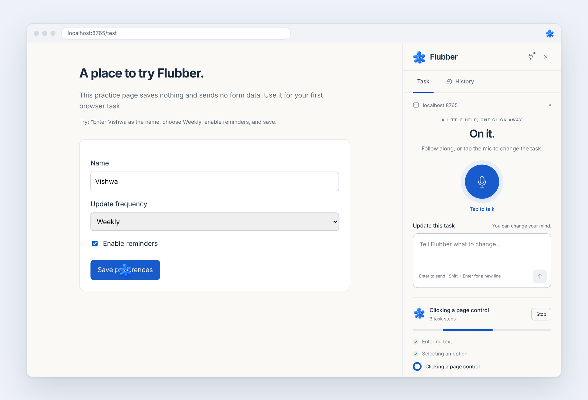
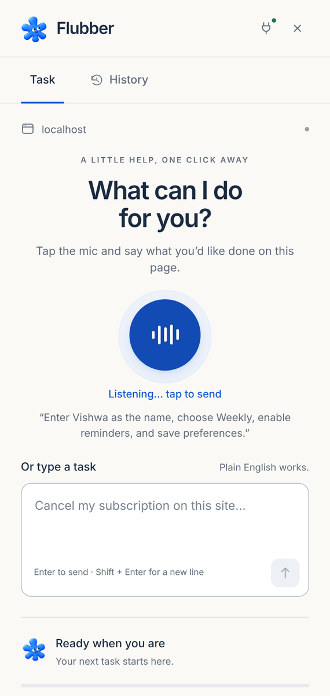
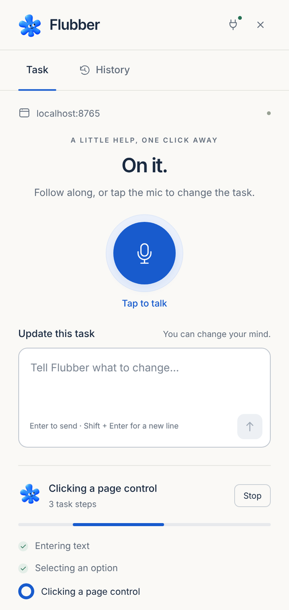
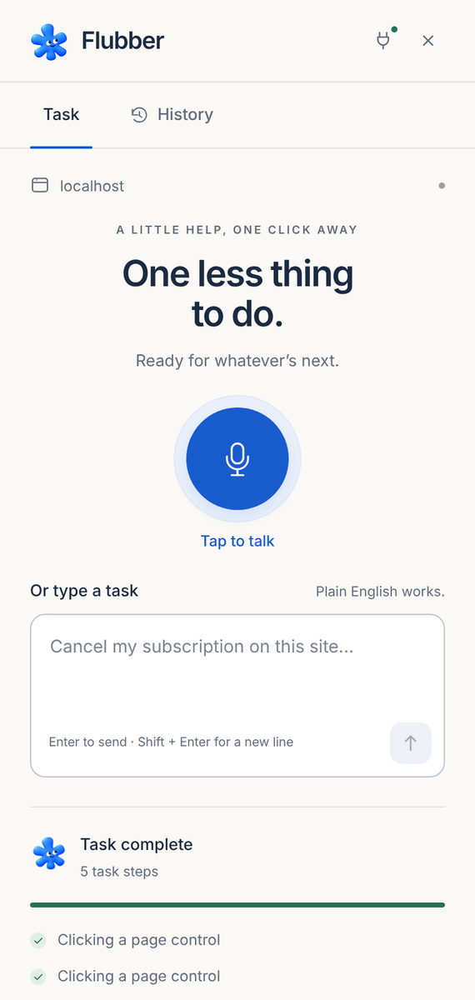
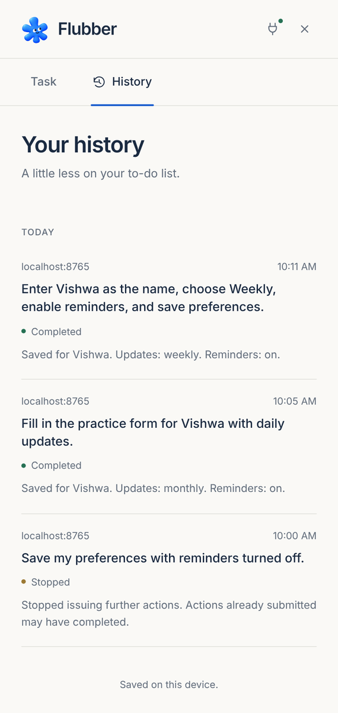

<p align="center">
  
</p>

<h1 align="center">Flubber</h1>

<p align="center">
  A voice-first browser assistant for Chrome.<br>
  Say what you want done on a page, and Flubber does it in your tab.
</p>

<p align="center">
  
</p>

## What it does

Open Flubber's side panel on any website, tap the mic, and say something like *"turn off marketing emails in my settings"*. Your voice is streamed to the **OpenAI Realtime API** and transcribed live. The transcript goes to a [Browser Use](https://github.com/browser-use/browser-use) agent running on your computer, which reads the page (DOM and screenshots), decides the next step with an OpenAI model, and clicks, types and selects in your real Chrome tab.

You can follow every step in the panel and watch the Flubber pointer move on the page. You can also change your mind halfway through: say "actually, make it monthly" and Flubber replans from where it is. Say "stop" and it stops.

<table>
  <tr>
    <td align="center"><br><sub>Listening</sub></td>
    <td align="center"><br><sub>Working</sub></td>
    <td align="center"><br><sub>Done</sub></td>
    <td align="center"><br><sub>History</sub></td>
  </tr>
</table>

## How it works

Flubber has two parts: a Chrome extension (the side panel) and a small Python program (the companion) that runs on your computer.

- **Voice.** The panel streams microphone audio over WebRTC to the OpenAI Realtime API. The companion creates a short-lived key for each voice session, so your real API key never reaches the browser.
- **Browser control.** The companion connects to your existing Chrome profile over the Chrome DevTools Protocol, so you stay logged in to your usual sites. Browser Use plans each action with an OpenAI model through the Responses API.
- **Live updates.** The companion pushes progress to the panel over a local WebSocket that only accepts the Flubber extension.
- **History.** Finished tasks and their results are saved on your computer.

## Setup

You'll need:

- Google Chrome 144 or newer
- Python 3.11 or newer (3.12 recommended), from [python.org](https://www.python.org/downloads/)
- Your own OpenAI API key (see [API keys](#api-keys))

**1. Get the code**

```sh
git clone https://github.com/Vishwadeep-Balakrishnan/flubber.git
```

Or click **Code → Download ZIP** on GitHub and unzip it somewhere you'll keep it.

**2. Add the extension to Chrome**

1. Go to `chrome://extensions` and turn on **Developer mode** (top right).
2. Click **Load unpacked** and choose the `extension` folder inside the project.
3. Pin Flubber from the puzzle-piece menu so the icon stays in your toolbar.

**3. Allow Flubber to control Chrome**

Go to `chrome://inspect/#remote-debugging` and turn on **Allow remote debugging for this browser instance**. The first time Flubber runs a task, Chrome may ask you to allow the connection. Click **Allow**.

**4. Start the companion**

| System  | Run |
| ------- | --- |
| Windows | Double-click `Start_Flubber.cmd` |
| macOS   | Double-click `Start_Flubber.command` |
| Linux   | `bash Start_Flubber.sh` |

The first launch takes a minute while it installs its dependencies. It then asks for your OpenAI API key. Paste it and press Enter (the text stays hidden). When it's ready, the terminal shows a **pairing code**. Leave this window open while you use Flubber.

**5. Connect the panel**

Click the Flubber icon in Chrome, then the plug icon at the top of the panel. Paste the pairing code from the terminal and click **Connect**. The small dot on the plug turns green.

**6. Try it**

Open `http://127.0.0.1:8765/test`. This is a practice form that doesn't send anything anywhere. Open Flubber, tap the mic and say:

> Enter Vishwa as the name, choose Weekly, enable reminders, and save preferences.

The first time you tap the mic, Chrome opens a tab asking for microphone access. Allow it, come back, and tap the mic again: tap once to start, tap again when you're done talking. You can also type tasks instead.

While it works, try saying "use Monthly instead", or press **Stop**.

## API keys

Flubber runs on your own OpenAI account, and you pay OpenAI directly for what you use.

1. Create a key at [platform.openai.com/api-keys](https://platform.openai.com/api-keys).
2. Make sure the project has billing set up and can use these models:

| Used for | Default model | Setting |
| --- | --- | --- |
| Planning browser actions (Responses API) | `gpt-6-luna` | `FLUBBER_MODEL` |
| Voice transcription (Realtime API) | `gpt-live-transcribe` | `FLUBBER_VOICE_MODEL` |

3. Give the key to Flubber in either of these ways:
   - Run the launcher and paste the key when it asks. It's saved in `companion/.env`.
   - Or copy `companion/.env.example` to `companion/.env` and fill in `OPENAI_API_KEY`.

If an `OPENAI_API_KEY` environment variable is set, it takes priority over the file.

**Where the key lives.** The key stays in `companion/.env` on your computer, and `.gitignore` keeps it out of git. The extension never stores or sees it. For voice, the companion asks OpenAI for a temporary key that works for one session and expires after two minutes, and that temporary key is the only one the browser receives.

**Changing the key.** Run `configure.py` with the companion's Python, then restart the companion:

```sh
# macOS / Linux
companion/.venv/bin/python companion/configure.py
# Windows
companion\.venv\Scripts\python.exe companion\configure.py
```

To check your setup without making any API calls:

```sh
companion/.venv/bin/python companion/run.py --check
```

## Settings

These are optional. Add them to `companion/.env` and restart the companion.

| Setting | Default | Description |
| --- | --- | --- |
| `FLUBBER_MODEL` | `gpt-6-luna` | Model that plans browser actions. It must accept images. |
| `FLUBBER_VOICE_MODEL` | `gpt-live-transcribe` | Realtime transcription model, for example `gpt-4o-transcribe`. |
| `FLUBBER_REASONING_EFFORT` | `low` | `none`, `low`, `medium`, `high`, `xhigh` or `max`. Higher is slower and more careful. |
| `FLUBBER_MAX_STEPS` | `40` | Most actions allowed in one task (1–200). |
| `FLUBBER_CDP_URL` | automatic | Only needed for a custom Chrome profile or debugging port, for example `http://127.0.0.1:9222`. |

## Using Flubber

- **Talk or type.** Both work the same way. While a task is running, anything you say or type is treated as a correction.
- **When Flubber needs you.** If a site asks for a login, a 2FA code or a CAPTCHA, or something unexpected comes up like an extra fee, Flubber pauses and asks you. Finish that step in Chrome, then reply in the panel.
- **History.** The History tab lists past tasks and results. Click one to run it again.
- **Limits.** Flubber works on regular websites in the tab you started from, plus any tabs that tab opens. It can't control Chrome's own pages (`chrome://`), upload files, or close your browser.

## Privacy and safety

- The companion only listens on `127.0.0.1`. Every request needs the pairing code, and only Chrome extensions are allowed to connect.
- Page text, screenshots and your voice are sent to OpenAI to complete a task. Browser Use's own cloud features and telemetry are turned off.
- The agent is instructed to treat text on websites as information, not instructions, and to stay within the task you gave it.
- Stop and corrections prevent anything further from happening, but they can't undo something a website has already received, such as a submitted form.

## Project structure

```
extension/            Chrome extension (no build step)
  sidepanel.*         Panel UI, voice over WebRTC, live updates
  background.js       Pairing, saved state, requests to the companion
  permission.*        One-time microphone permission page
companion/            Python companion
  run.py              Starts the local server
  configure.py        Saves your API key
  flubber/
    server.py         Local API and WebSocket
    tasks.py          Starting, correcting and stopping tasks; history
    engine.py         Browser Use agent connected to Chrome
    model.py          OpenAI Responses API adapter
    voice.py          Temporary Realtime API keys for voice
    pointer.py        On-page Flubber pointer and safety checks
  test-page/          Practice form served at /test
docs/                 Screenshots
Start_Flubber.*       Launchers for Windows, macOS and Linux
```

## Development

The tests don't need an API key.

```sh
# Python tests (run the launcher once first to create .venv)
cd companion
.venv/bin/python -m unittest discover -s tests -v

# Extension tests (Node 18+)
node --test extension/tests/background.test.cjs

# Optional browser tests (needs Playwright: npm i playwright && npx playwright install chromium)
node extension/tests/ui.browser.cjs
node extension/tests/mascot.browser.cjs
```

`companion/tests/browser_smoke.py` runs the real Browser Use agent on the practice page with scripted model replies. Run it with `--help` for its options.

## Built with

[Browser Use](https://github.com/browser-use/browser-use), the [OpenAI Realtime API](https://platform.openai.com/docs/guides/realtime) and [Responses API](https://platform.openai.com/docs/api-reference/responses), [aiohttp](https://docs.aiohttp.org/), and Chrome Manifest V3.
